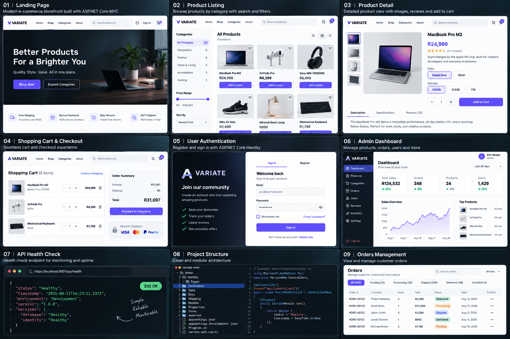

# Variate

**Variate** is an e-commerce platform: an ASP.NET Core MVC storefront on SQL Server, a set of .NET microservices for Azure Kubernetes Service, and a Python shopping assistant that uses Claude and OpenAI and comes with its own evals, observability and security controls.




## Features

- **User Authentication**: Secure login and registration functionality.
- **Product Management**: Browse and search through a diverse range of product categories.
- **Shopping Cart**: Add, update, and remove items in the shopping cart.
- **Order Management**: Place orders and track order status.
- **Payment Gateway Integration**: Secure and reliable payment processing.
- **Responsive Design**: Optimized for both desktop and mobile devices.
- **Shopping Assistant**: Intent routing, hybrid product search, grounded product answers and order lookups. It is measured by an offline eval suite and instrumented with traces, cost tracking and Prometheus metrics.

## Product Categories

- **Electronics**
- **Home and Kitchen**
- **Fashion and Beauty**
- **Musical Instruments**
- **Art and Crafts**
- **Baby and Toddler**
- **Bed and Bath**
- **Decor and Furniture**
- **Health and Beauty**
- **Home and Garden**
- **Jewellery and Watches**
- **Luggage and Travel**
- **Office and Stationery**
- **Pet Products**
- **Sports and Outdoor**
- **Tools and DIY"**
- **Toys and Games"**

## Technology Stack

- **Backend**: ASP.NET Core
- **Frontend**: Razor Pages
- **Database**: SQL Server
- **Payment Gateway**: [PayPal](https://paypal.com)
- **Hosting**: [Azure](https://azure.com)
- **Assistant**: Python, FastAPI, Pydantic, scikit-learn, Anthropic Claude (Haiku 5.5, Sonnet 5.5, Opus 5.5), OpenAI embeddings, Prometheus

## Microservices Platform (AKS)

This repository now includes a production-style microservices platform under [platform/README.md](platform/README.md) with:

- JWT auth service
- Catalog, order, payment, and notification services
- Assistant service (Python/FastAPI): routing cascade, hybrid search, evals and tracing
- RabbitMQ for async event-driven flows
- API gateway service
- Containerized SQL Server
- Docker Compose for local orchestration
- Kubernetes manifests for AKS
- Terraform for Azure AKS/ACR/network infrastructure
- Ansible playbooks for build/push/deploy automation

## Shopping Assistant

[`platform/src/AssistantService`](platform/src/AssistantService/README.md) is a Python service behind the gateway at `/api/v1/assistant/*`. It:

- Routes each message through a small distilled classifier and escalates only uncertain messages to Claude Haiku 5.5.
- Searches the catalog with BM25 plus dense embeddings, fused with reciprocal rank fusion, filtered on exact price and sale constraints, then reranked.
- Answers product questions with Claude Sonnet 5.5, using only catalog facts.
- Serves order status and store policies without a model. They are an API lookup and fixed, reviewed text, which a model would only make slower and less reliable.
- Is measured by `python -m evals.run all`, which reports routing accuracy with confidence intervals, retrieval recall, MRR and nDCG, groundedness, p50/p95 latency and cost per 1k calls. CI fails on regressions.
- Logs a JSON trace for every request (spans, tokens, cost) and exposes Prometheus metrics by tenant and model.

Security controls:

- the service verifies JWTs itself, and order lookups are scoped to the token subject
- tenants come from an allow-list, and the gateway sets the tenant header
- structured outputs limit what a model can return
- per-tenant rate limits and daily model budgets
- the container runs as non-root with a read-only filesystem, and a NetworkPolicy restricts egress

Results and design decisions are in [docs/assistant-writeup.md](docs/assistant-writeup.md).

## Getting Started

### Prerequisites

- [.NET Core SDK](https://dotnet.microsoft.com/download)
- [SQL Server](https://www.microsoft.com/sql-server) (or the container in `platform/docker-compose.yml`)
- [Python 3.12+](https://www.python.org/downloads/) for the assistant service

### Installation

1. **Clone the repository:**
   ```bash
   git clone https://github.com/7irelo/variate-web.git
   cd variate-web
   ```

2. **Configure the database:**
   - Update the connection string in `appsettings.json` to match your SQL Server setup.

3. **Apply database migrations:**
   ```bash
   dotnet ef database update
   ```

4. **Run the application:**
   ```bash
   dotnet run
   ```

5. **Visit the application:**
   Open your browser and navigate to `http://localhost:5263`

6. **Run the assistant service (optional):**
   ```bash
   cd platform/src/AssistantService
   pip install -r requirements-dev.txt
   python -m distill.train --labels gold
   uvicorn assistant.main:app --port 8080
   python -m evals.run all
   ```
   Set `ANTHROPIC_API_KEY` and `OPENAI_API_KEY` to enable the model-backed paths. Without them the service runs fully offline.

## Contributing

We welcome contributions to enhance Variate. To contribute:

1. Fork the repository.
2. Create a new branch for your feature or bugfix.
   ```bash
   git checkout -b feature-name
   ```
3. Commit your changes.
   ```bash
   git commit -m "Description of your feature"
   ```
4. Push to the branch.
   ```bash
   git push origin feature-name
   ```
5. Open a Pull Request.

## License

This project is licensed under the MIT License - see the [LICENSE](LICENSE) file for details.

## Contact

For any inquiries or feedback, feel free to reach out:

- Email: [tirelo.eric@gmail.com](mailto:tirelo.eric@gmail.com)
- Website: [www.variate.com](http://www.variate.com)

Thank you for using Variate! Happy shopping!
